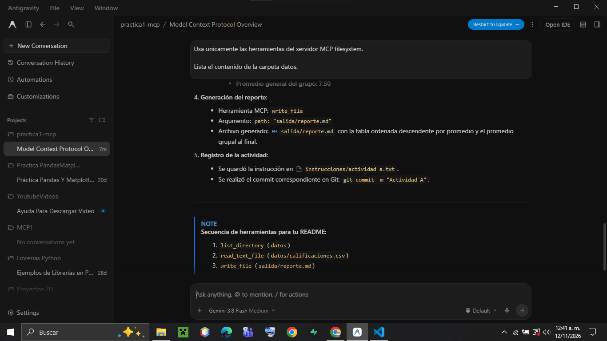
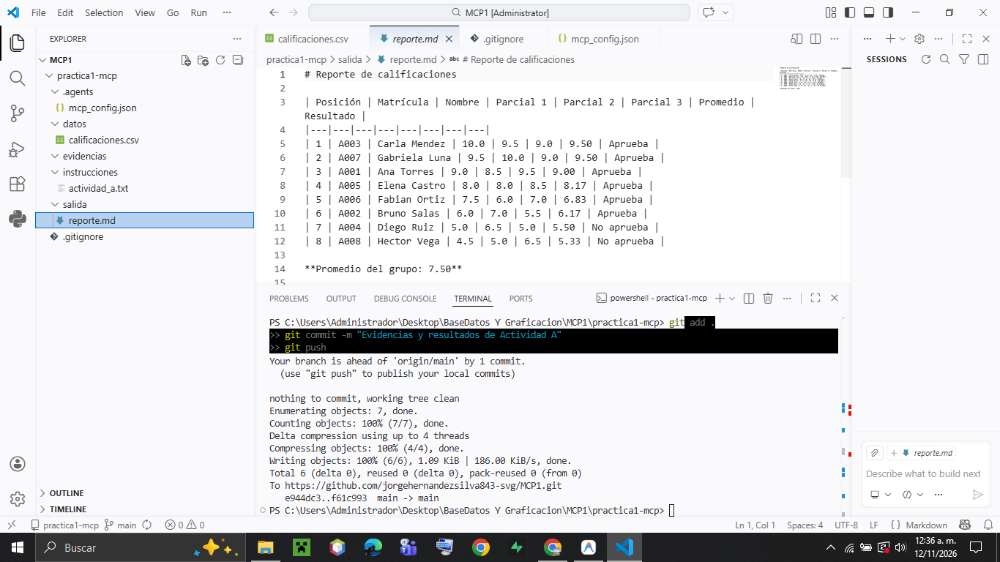
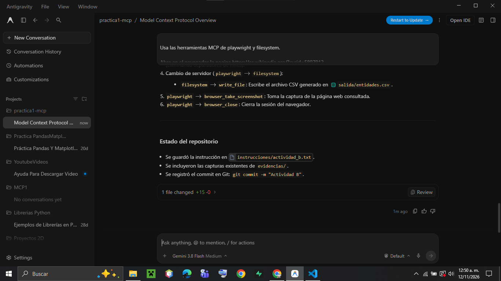
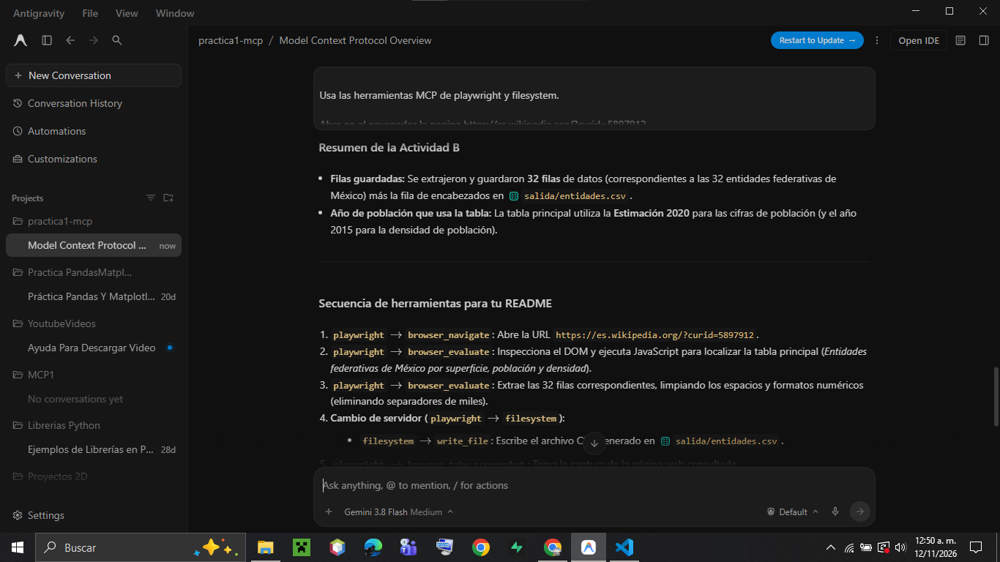
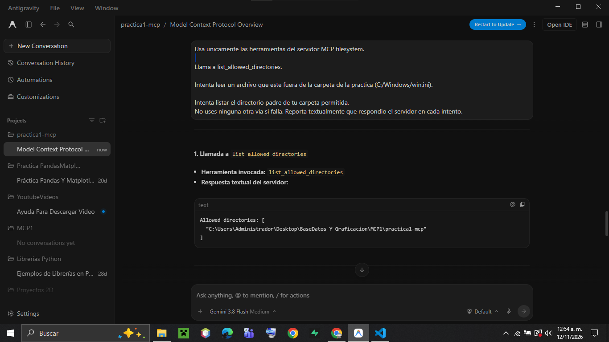

# Práctica 1: Conectar Servidores MCP a un Agente

**Asignatura:** Bases de Datos y Graficación  
**Estudiante:** Jorge Silva  
**Herramienta / Agente:** Google Antigravity IDE  
**Repositorio GitHub:** [https://github.com/jorgehernandezsilva843-svg/MCP1.git](https://github.com/jorgehernandezsilva843-svg/MCP1.git)

---

## 1. Descripción General

Esta práctica tiene como objetivo la implementación, configuración y evaluación del estándar **Model Context Protocol (MCP)** en un entorno de desarrollo asistido por Inteligencia Artificial (Google Antigravity). MCP permite desacoplar las capacidades de ejecución y acceso a recursos externos del modelo de lenguaje, proporcionando una arquitectura estandarizada cliente-servidor basada en **JSON-RPC 2.0 sobre transporte stdio**.

A través de esta práctica se integran y coordinan múltiples servidores MCP independientes (`filesystem`, `playwright` y `memory`) para realizar flujos de trabajo compuestos: manipulación de sistemas de archivos locales, extracción y automatización web en navegadores headless, análisis de barreras de seguridad perimetral del servidor (*sandboxing*) y gestión de persistencia estructurada mediante grafos de conocimiento.

---

## 2. Requisitos y Reproducción

### Requisitos del Sistema
- **Sistema Operativo:** Windows 10/11 x64 (compatible con macOS / Linux).
- **Node.js:** Versión 18 o superior (verificado con `Node.js v25.6.0` y `npx v11.8.0`).
- **Navegador Web:** Google Chrome o Microsoft Edge.
- **Git:** Versión 2.40+ (verificado con `git v2.53.0.windows.1`).
- **Google Antigravity:** IDE con soporte nativo para Model Context Protocol.

### Pasos para Reproducir la Práctica desde Cero

1. **Clonar el repositorio:**
   ```bash
   git clone https://github.com/jorgehernandezsilva843-svg/MCP1.git
   cd MCP1
   ```

2. **Ajustar la ruta absoluta en la configuración MCP:**
   Abre el archivo [`.agents/mcp_config.json`](.agents/mcp_config.json) (o copia su contenido a `~/.gemini/config/mcp_config.json`) y reemplaza el argumento del directorio de `filesystem` con tu ruta local absoluta:
   ```json
   "filesystem": {
     "command": "cmd",
     "args": [
       "/c",
       "npx",
       "-y",
       "@modelcontextprotocol/server-filesystem",
       "C:\\TU_RUTA_COMPLETA\\practica1-mcp"
     ]
   }
   ```
   *(Nota: En Windows cada barra diagonal invertida debe duplicarse `\\`).*

3. **Cargar los servidores en Antigravity:**
   - Abre la carpeta del proyecto en Google Antigravity IDE.
   - En el menú de tres puntos (**`...`**) del panel de chat, accede a **MCP Servers** y verifica que los servidores figuren con estado activo.

---

## 3. Estructura del Repositorio

```text
practica1-mcp/
├── .agents/
│   └── mcp_config.json           # Configuración de los 3 servidores MCP del proyecto
├── datos/
│   └── calificaciones.csv        # Archivo origen de calificaciones (Actividad A)
├── salida/
│   ├── reporte.md                # Reporte Markdown con promedios ordenados (Actividad A)
│   └── entidades.csv             # Dataset consolidado de 32 entidades federativas (Actividad B)
├── instrucciones/
│   ├── actividad_a.txt           # Prompt de la Actividad A
│   ├── actividad_b.txt           # Prompt de la Actividad B
│   ├── actividad_c.txt           # Prompt de la Actividad C
│   └── actividad_d.txt           # Prompt de la Actividad D
├── evidencias/
│   ├── srvr_anterior.png         # Captura del estado de servidores MCP
│   ├── act_a.png                 # Captura de ejecución de la Actividad A
│   ├── act_a1.png                # Captura complementaria de la Actividad A
│   ├── act_b.png                 # Captura de navegación y extracción de la Actividad B
│   ├── act_b1.png                # Captura complementaria de la Actividad B
│   └── act_c.png                 # Captura del rechazo de acceso en Actividad C
├── .gitignore                    # Reglas de exclusión (ignora .playwright-mcp/)
└── README.md                     # Documentación técnica completa
```

---

## 4. Servidores MCP Configurados

El archivo [`.agents/mcp_config.json`](.agents/mcp_config.json) registra los siguientes tres servidores:

| Servidor | Paquete NPM / Publicador | Propósito | Herramientas Principales Expuestas |
| :--- | :--- | :--- | :--- |
| **`filesystem`** | `@modelcontextprotocol/server-filesystem` *(Mantenedores MCP / Anthropic)* | Acceso controlado al sistema de archivos local dentro de un directorio delimitado. | `list_directory`, `read_text_file`, `write_file`, `list_allowed_directories`, `get_file_info`, `move_file`, `search_files`. |
| **`playwright`** | `@playwright/mcp@latest` *(Microsoft)* | Automatización e inspección de navegadores web en tiempo real. | `browser_navigate`, `browser_evaluate`, `browser_take_screenshot`, `browser_click`, `browser_close`. |
| **`memory`** | `@modelcontextprotocol/server-memory` *(Mantenedores MCP / Anthropic)* | Persistencia de datos basada en grafos de conocimiento estructurados (entidades, tipos, relaciones y observaciones). | `create_entities`, `create_relations`, `add_observations`, `read_graph`, `search_nodes`, `open_nodes`. |

---

## 5. Desarrollo de Actividades

### Actividad A: Lectura y Escritura de Archivos Locales (`filesystem`)

* **Instrucción dada:** Se solicitó listar la carpeta `datos/`, leer `calificaciones.csv`, calcular la media aritmética de tres parciales por alumno, determinar si aprueban ($\ge 6.00$) y redactar una tabla Markdown descendente en `salida/reporte.md` con el promedio grupal.
* **Secuencia de herramientas MCP invocadas:**
  1. `filesystem` $\rightarrow$ `list_directory(path: "datos")`: Identificó el archivo `calificaciones.csv`.
  2. `filesystem` $\rightarrow$ `read_text_file(path: "datos/calificaciones.csv")`: Obtuvo los registros de 8 alumnos.
  3. `filesystem` $\rightarrow$ `write_file(path: "salida/reporte.md", content: ...)`: Generó el reporte formateado.
* **Resultado:**
  - Archivo [`salida/reporte.md`](salida/reporte.md) con 8 estudiantes:
    - **6 alumnos aprueban:** Carla Mendez (9.50), Gabriela Luna (9.50), Ana Torres (9.00), Elena Castro (8.17), Fabian Ortiz (6.83), Bruno Salas (6.17).
    - **2 alumnos no aprueban:** Diego Ruiz (5.50), Hector Vega (5.33).
    - **Promedio grupal:** **7.50**
* **Evidencias:**
  
  
  

---

### Actividad B: De una Página Web a un CSV (`playwright` + `filesystem`)

* **Instrucción dada:** Abrir en el navegador la página de Wikipedia (`https://es.wikipedia.org/?curid=5897912`), ubicar la tabla con las 32 entidades federativas de México, extraer superficie en $\text{km}^2$, población y densidad, guardando los datos limpios en `salida/entidades.csv`, tomar captura y cerrar el navegador.
* **Secuencia de herramientas MCP invocadas:**
  1. `playwright` $\rightarrow$ `browser_navigate`: Accedió a la URL del artículo.
  2. `playwright` $\rightarrow$ `browser_evaluate`: Evaluó selectores JavaScript en el DOM, identificando la tabla 0 (*Entidades federativas de México por superficie, población y densidad*).
  3. `playwright` $\rightarrow$ `browser_evaluate`: Extrajo las 32 entidades sanitizando los datos numéricos (removiendo espacios de no separación y comas decimales).
  4. **Cambio de servidor (`playwright` $\rightarrow$ `filesystem`):**
     - En el paso 4 se alternó al servidor `filesystem` llamando a `write_file(path: "salida/entidades.csv")`.
  5. `playwright` $\rightarrow$ `browser_take_screenshot`: Capturó la vista de la página web.
  6. `playwright` $\rightarrow$ `browser_close`: Terminó la instancia del navegador.
* **Resultado:**
  - Archivo [`salida/entidades.csv`](salida/entidades.csv) con encabezado y **32 filas**.
  - Primera entidad: **Chihuahua** (Superficie: $247455\text{ km}^2$, Población: $3741869$, Densidad: $14\text{ hab/km}^2$).
  - **Año de población de la tabla:** **Estimación 2020** (densidad registrada con base en 2015).
* **Evidencias:**
  
  
  

---

### Actividad C: Comprobación de Límites de Acceso y Seguridad (`filesystem`)

* **Instrucción dada:** Llamar a `list_allowed_directories`, intentar leer un archivo del sistema fuera de la carpeta (`C:/Windows/win.ini`) e intentar listar el directorio padre de la práctica. Reportar textualmente la respuesta del servidor.
* **Secuencia y Respuestas Textuales del Servidor:**
  1. `list_allowed_directories`:
     ```text
     Allowed directories: [ "C:\Users\Administrador\Desktop\BaseDatos Y Graficacion\MCP1\practica1-mcp" ]
     ```
  2. `read_text_file(path: "C:/Windows/win.ini")`:
     ```text
     Access denied - path outside allowed directories: C:\Windows\win.ini not in C:\Users\Administrador\Desktop\BaseDatos Y Graficacion\MCP1\practica1-mcp
     ```
  3. `list_directory(path: "C:/Users/Administrador/Desktop/BaseDatos Y Graficacion/MCP1")`:
     ```text
     Access denied - path outside allowed directories: C:\Users\Administrador\Desktop\BaseDatos Y Graficacion\MCP1 not in C:\Users\Administrador\Desktop\BaseDatos Y Graficacion\MCP1\practica1-mcp
     ```
* **Análisis de Seguridad: ¿Quién impuso el límite?**
  **El servidor MCP (`@modelcontextprotocol/server-filesystem`)**.
  Ni el modelo de lenguaje (LLM) ni el cliente/host bloquearon la solicitud; el modelo generó la intención y la transmitió por JSON-RPC. Fue el proceso independiente del servidor el que verificó las rutas canónicas contra su lista blanca antes de tocar el sistema de archivos del sistema operativo, abortando la llamada con `Access denied`. Esto demuestra que la seguridad perimetral de MCP garantiza robustez frente a inyecciones de prompts o alucinaciones del modelo.
* **Evidencias:**
  
  

---

### Actividad D: Tercer Servidor MCP Libre (`memory`)

* **Servidor Elegido:** `@modelcontextprotocol/server-memory`.
* **Publicador:** Mantenedores del Model Context Protocol (Anthropic Open Source).
* **Justificación de Confianza:** Es el paquete de referencia oficial mantenido por el consorcio de MCP, de código abierto, auditado y libre de dependencias o telemetría externa.
* **Herramientas Expuestas:** `create_entities`, `create_relations`, `add_observations`, `read_graph`, `search_nodes`, `open_nodes`.
* **Tarea Diseñada y Resuelta:**
  - Se estructuró un grafo de conocimiento para un curso de bases de datos.
  - Se invocó `create_entities` para registrar:
    - `CursoBD` (Tipo: *Curso*, Observación: *"Curso corto de bases de datos"*).
    - `SQL` (Tipo: *Modulo*, Observación: *"Módulo de bases de datos relacionales y lenguaje SQL"*).
    - `NoSQL` (Tipo: *Modulo*, Observación: *"Módulo de bases de datos no relacionales, documentos y grafos"*).
  - Se invocó `create_relations` para enlazar los nodos:
    - `CursoBD` $\xrightarrow{\text{contiene\_modulo}}$ `SQL`
    - `CursoBD` $\xrightarrow{\text{contiene\_modulo}}$ `NoSQL`
  - Se consultó el grafo resultante mediante `read_graph`, confirmando la persistencia y conectividad bidireccional de los conceptos.

---

## 6. Problemas Encontrados y Soluciones

1. **Invocación de `npx` en entorno Windows:**
   - *Problema:* En Windows, lanzar ejecutables globales de Node directamente desde el host generaba fallas de arranque en el subproceso de stdio.
   - *Solución:* Se antepuso `cmd /c` en el comando (`"command": "cmd"`, `"args": ["/c", "npx", "-y", ...]`), asegurando la resolución adecuada de las variables de entorno de Windows.
2. **Espacios en nombres de directorio:**
   - *Problema:* La ruta contenía espacios (`BaseDatos Y Graficacion`).
   - *Solución:* Se delimitó con precisión el parámetro de ruta en el archivo JSON escapando correctamente las comillas y barras diagonales.
3. **Certificados TLS locales en Node v25:**
   - *Problema:* Al consultar URLs externas con la librería interna de Node se reportó `UNABLE_TO_VERIFY_LEAF_SIGNATURE`.
   - *Solución:* Se empleó la bandera `--use-system-ca` para validar los certificados contra el almacén nativo de certificados raíz de Windows.

---

## 7. Fuentes y Referencias

- **Especificación del Protocolo MCP:** [https://modelcontextprotocol.io](https://modelcontextprotocol.io)
- **Repositorio Oficial de Servidores MCP:** [https://github.com/modelcontextprotocol/servers](https://github.com/modelcontextprotocol/servers)
- **Servidor Playwright MCP:** [https://github.com/microsoft/playwright-mcp](https://github.com/microsoft/playwright-mcp)
- **Documentación de Antigravity MCP:** [https://antigravity.google/docs/mcp](https://antigravity.google/docs/mcp)
- **Fuente de Datos (Actividad B):** Wikipedia, [*Anexo: Entidades federativas de México por superficie, población y densidad*](https://es.wikipedia.org/?curid=5897912).
